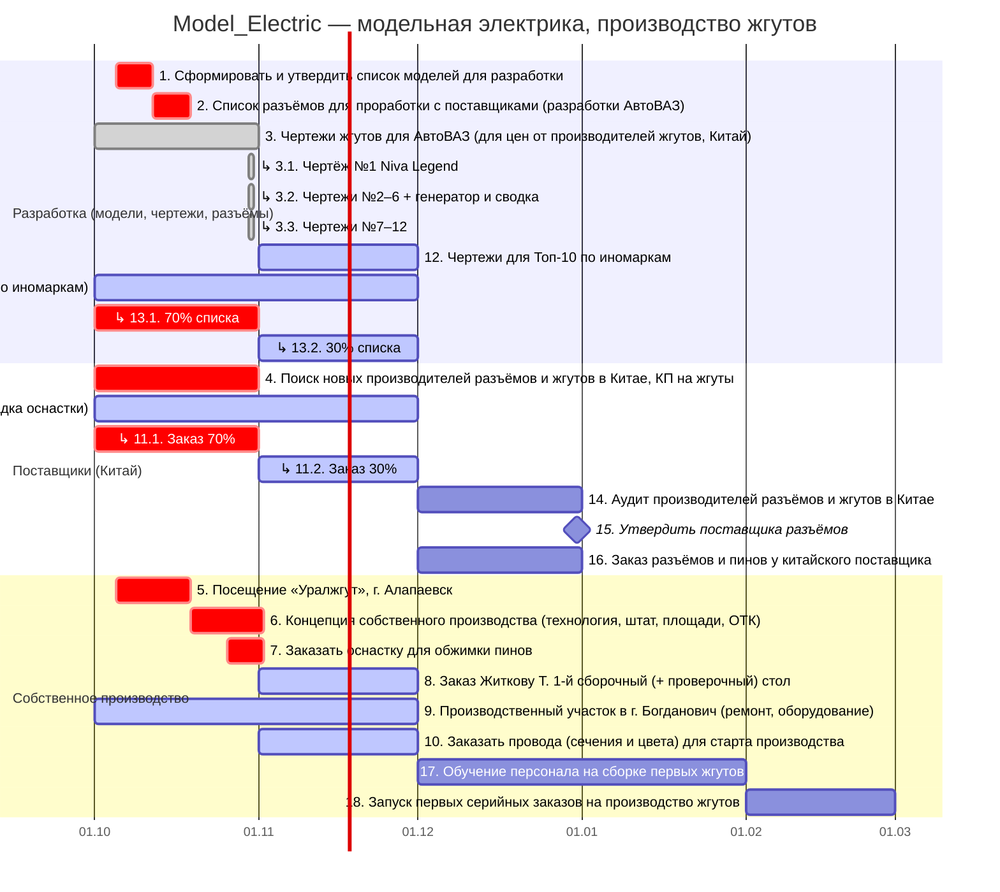

# Model_Electric — модельная электрика, производство жгутов: диаграмма Ганта

Обновлено: 07.11.26. Источник: [`plan.yaml`](plan.yaml), генератор: `python3 tools/build_gantt.py`. Excel-версия: [`Gantt.xlsx`](Gantt.xlsx).

## Сводка

Задач и вех: **18**, общий прогресс **6%**.

- ✅ выполнено: 1
- 🔄 в работе: 6
- ⏳ запланировано: 5
- ⚠️ срок прошёл — подтвердить: 6

## Диаграмма

## Задачи по направлениям

### Разработка (модели, чертежи, разъёмы)

| № | Задача | Срок | Даты | Статус | % | Отв. | Примечание |
|---|---|---|---|---|---|---|---|
| 1 | Сформировать и утвердить список моделей для разработки | W41 | 05.10.26 – 11.10.26 | ⚠️ срок прошёл — подтвердить | 0 |  |  |
| 2 | Список разъёмов для проработки с поставщиками (разработки АвтоВАЗ) | W42 | 12.10.26 – 18.10.26 | ⚠️ срок прошёл — подтвердить | 0 |  | после: 1 |
| 3 | Чертежи жгутов для АвтоВАЗ (для цен от производителей жгутов, Китай) | Октябрь | 01.10.26 – 31.10.26 | ✅ выполнено | 100 |  | В репозитории: спецификации по чертежам №1–12 (specs/), сводка specs/Summary_all_drawings.xlsx |
| 3.1 | ↳ Чертёж №1 Niva Legend |  | 30.10.26 – 30.10.26 | ✅ выполнено | 100 |  |  |
| 3.2 | ↳ Чертежи №2–6 + генератор и сводка |  | 30.10.26 – 30.10.26 | ✅ выполнено | 100 |  |  |
| 3.3 | ↳ Чертежи №7–12 |  | 30.10.26 – 30.10.26 | ✅ выполнено | 100 |  |  |
| 12 | Чертежи для Топ-10 по иномаркам | Ноябрь | 01.11.26 – 30.11.26 | 🔄 в работе | 0 |  |  |
| 13 | Список разъёмов для проработки с поставщиками (разработки по иномаркам) | 70% Октябрь, 30% Ноябрь | 01.10.26 – 30.11.26 | 🔄 в работе | 0 |  |  |
| 13.1 | ↳ 70% списка |  | 01.10.26 – 31.10.26 | ⚠️ срок прошёл — подтвердить | 0 |  |  |
| 13.2 | ↳ 30% списка |  | 01.11.26 – 30.11.26 | 🔄 в работе | 0 |  |  |

### Поставщики (Китай)

| № | Задача | Срок | Даты | Статус | % | Отв. | Примечание |
|---|---|---|---|---|---|---|---|
| 4 | Поиск новых производителей разъёмов и жгутов в Китае, КП на жгуты | Октябрь | 01.10.26 – 31.10.26 | ⚠️ срок прошёл — подтвердить | 0 |  | после: 3 |
| 11 | Партия разъёмов с пинами у разных китайских производителей (тест-сборки, наладка оснастки) | 70% Октябрь, 30% Ноябрь | 01.10.26 – 30.11.26 | 🔄 в работе | 0 |  |  |
| 11.1 | ↳ Заказ 70% |  | 01.10.26 – 31.10.26 | ⚠️ срок прошёл — подтвердить | 0 |  |  |
| 11.2 | ↳ Заказ 30% |  | 01.11.26 – 30.11.26 | 🔄 в работе | 0 |  |  |
| 14 | Аудит производителей разъёмов и жгутов в Китае | Декабрь | 01.12.26 – 31.12.26 | ⏳ запланировано | 0 |  | после: 4 |
| 15 | ◆ Утвердить поставщика разъёмов | Декабрь | 31.12.26 | ⏳ запланировано | 0 |  | после: 14 |
| 16 | Заказ разъёмов и пинов у китайского поставщика | Декабрь | 01.12.26 – 31.12.26 | ⏳ запланировано | 0 |  | после: 15 |

### Собственное производство

| № | Задача | Срок | Даты | Статус | % | Отв. | Примечание |
|---|---|---|---|---|---|---|---|
| 5 | Посещение «Уралжгут», г. Алапаевск | W41–42 | 05.10.26 – 18.10.26 | ⚠️ срок прошёл — подтвердить | 0 |  |  |
| 6 | Концепция собственного производства (технология, штат, площади, ОТК) | W43–44 | 19.10.26 – 01.11.26 | ⚠️ срок прошёл — подтвердить | 0 |  | после: 5 |
| 7 | Заказать оснастку для обжимки пинов | W44 | 26.10.26 – 01.11.26 | ⚠️ срок прошёл — подтвердить | 0 |  |  |
| 8 | Заказ Житкову Т.: 1-й сборочный (+ проверочный) стол | Ноябрь | 01.11.26 – 30.11.26 | 🔄 в работе | 0 | Житков Т. | после: 6 |
| 9 | Производственный участок в г. Богданович (ремонт, оборудование) | Октябрь–Ноябрь | 01.10.26 – 30.11.26 | 🔄 в работе | 0 |  |  |
| 10 | Заказать провода (сечения и цвета) для старта производства | Ноябрь | 01.11.26 – 30.11.26 | 🔄 в работе | 0 |  |  |
| 17 | Обучение персонала на сборке первых жгутов | Декабрь–Январь | 01.12.26 – 31.01.27 | ⏳ запланировано | 0 |  | после: 8, 9 |
| 18 | Запуск первых серийных заказов на производство жгутов | Февраль | 01.02.27 – 28.02.27 | ⏳ запланировано | 0 |  | после: 16, 17 |

## Как обновлять

1. Поменять `status` / `progress` / даты в [`plan.yaml`](plan.yaml).
2. `python3 tools/build_gantt.py`
3. Закоммитить `project/`.

Задача, у которой срок прошёл, а статус не `done`, отображается как «⚠️ срок прошёл — подтвердить».
